<h3 align="center">
  
  Anonymous Chat · Frontend
  
  <br/>
  <a href="https://github.com/h3n-x/chat-frontend">Zero-knowledge web and Android client: native WebCrypto in RAM, React 19 and Capacitor</a>
  <br/><br/>
  <p>
    🌐 <strong>English</strong> · <a href="README.es.md">Español</a>
  </p>
</h3>

<p align="center">
  
  
  
  
</p>

<p align="center">
  
  
  
  
</p>

<p align="center">
  <a href="https://chat-zk.netlify.app">Live demo</a>
  ·
  <a href="https://github.com/h3n-x/chat-anonimo">Umbrella repo</a>
  ·
  <a href="https://github.com/h3n-x/chat-backend">Backend</a>
  ·
  <a href="LICENSE">License</a>
</p>

&nbsp;

<p align="center">
  
</p>

&nbsp;

## 🪄 About

The web and mobile client of [Anonymous Chat](https://github.com/h3n-x/chat-anonimo): ultra-private messaging with every
cryptographic operation isolated in the browser's RAM, zero persistent storage, WCAG 2.2 AA accessible design and a fully
responsive interface.

Most "end-to-end encrypted" web messengers are exposed to heavy, unaudited third-party crypto libraries, keys or messages
silently written to `localStorage`, IndexedDB or caches, EXIF metadata (GPS, phone model, time) leaking from attached photos, and
full exposure when someone is forced to unlock the device. This client runs **100% of the cryptography and media handling in
RAM**:

| | |
|---|---|
| 💾 **Zero persistence** | No `localStorage`, no cookies, no Service Workers storing messages. |
| 🚫 **Fail-closed** | If `window.crypto.subtle` is missing, the app refuses to run. |
| 🕵️ **Built-in anti-forensics** | Duress mode, clipboard scrubbing, steganography and voice scrambling. |

&nbsp;

## 📱 Mobile-first interface

| | |
|---|---|
| ⌨️ **Two-level input bar** | A top ribbon of ephemeral-security pills (`🔥 self-destruct off/10s/30s/1m/5m`, `👁️ view once`, `🖼️ steganography`) and a bottom row with attach, a full-width text area that never shrinks on small phones, a voice-note recorder and the send button. |
| 😀 **Touch reactions** | Encrypted ephemeral reactions (`👍` `❤️` `🔥` `🤫` `👁️`) through a floating touch menu that doesn't rely on mouse `:hover`, with grouped counters. |
| ☰ **Smart header** | Desktop shows every tool inline; below `sm` it condenses into the room code, `QR / key`, the panic button and a `⋯` sheet with RAM search (`Ctrl + F`), spy mode (blurred messages), decoy traffic, sounds, Tor and relay settings, and leave room. |
| 🛡️ **Collapsible security panel** | Encryption state (`E2EE: AES-256-GCM`), live RTT to the relay, participants and a blinking **SAS verification** warning until it's validated; one line on mobile, expandable to audit the 4-word fingerprint. |

&nbsp;

## ✨ Security modules

| Module | What it does |
|---|---|
| 🎙️ **Voice scrambler** (`src/utils/voiceScrambler.ts`) | Web Audio `BiquadFilterNode`, `DelayNode` and `GainNode` reshape formants and pitch before WebM encoding: deep, helium, cyborg (ring modulation) and whisper, against voiceprint forensics. |
| 🧹 **Metadata scrubber** (`src/utils/fileSanitizer.ts`) | Redraws images on a metadata-free `<canvas>`, removing EXIF, GPS, camera serials and timestamps, and renames files to `SHA-256(timestamp + random)`. |
| 👁️ **View-once media** (`src/components/ViewOnceModal.tsx`) | A 7-second timer, blur when the window loses focus, and `URL.revokeObjectURL()` on close, marking the message as burnt. |
| 🎭 **Duress mode and decoy room** (`src/components/DecoyRoom.tsx`) | PIN `9999`, `/duress` or `Ctrl + Shift + D` wipe every key in memory and mount a working, innocent university study group chat. |
| 📋 **Self-destructing clipboard** (`src/utils/secureClipboard.ts`) | Copied room keys, links and mnemonics are overwritten with an empty string after 30 seconds. |
| 🖼️ **LSB steganography** (`src/utils/steganography.ts`) | Writes a `ZKST` magic marker, a 32-bit length and a UTF-8 payload into the lowest RGB bits of lossless PNGs, from an interactive modal. |
| 🔤 **BIP-39 mnemonics** (`src/utils/bip39.ts`) | The Bitcoin BIP-39 standard (2048 words, Spanish and English) encodes the 256-bit key as 24 words with an 8-bit SHA-256 checksum. |
| 📱 **Android with `FLAG_SECURE`** (`android/`) | A Capacitor project whose `MainActivity.java` blocks screenshots (`Power + Vol-`), malware screen recording and task-switcher previews, and normalizes the WebView user agent. |

&nbsp;

## 🚀 Quick start

```bash
npm install
npm run dev               # development server
npm run build             # production build (strict TypeScript + Vite)
npx cap sync android      # sync with the native Android project
```

> [!TIP]
> Try it live: [chat-zk.netlify.app](https://chat-zk.netlify.app).

&nbsp;

## 🧪 Testing

12 unit tests guard the algorithms (`npm test -- --run`):

```text
 ✓ src/utils/fileSanitizer.test.ts (3 tests)
 ✓ src/utils/bip39.test.ts (4 tests)
 ✓ src/crypto/crypto.test.ts (5 tests)

 Test Files  3 passed (3)
      Tests  12 passed (12)
```

&nbsp;

<p align="center">
  
</p>

<p align="center">
  Copyright © 2026 <a href="https://github.com/h3n-x">h3n-x</a>
</p>

<p align="center">
  <a href="https://github.com/h3n-x/chat-frontend/blob/main/LICENSE"></a>
</p>
